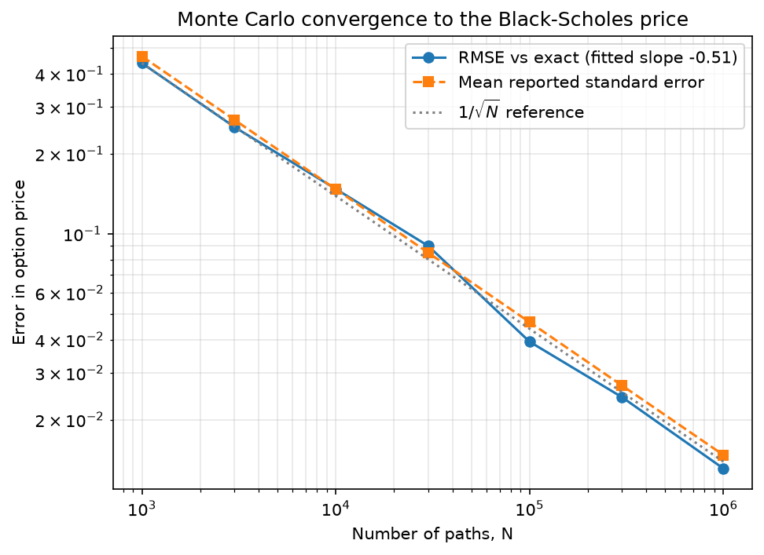
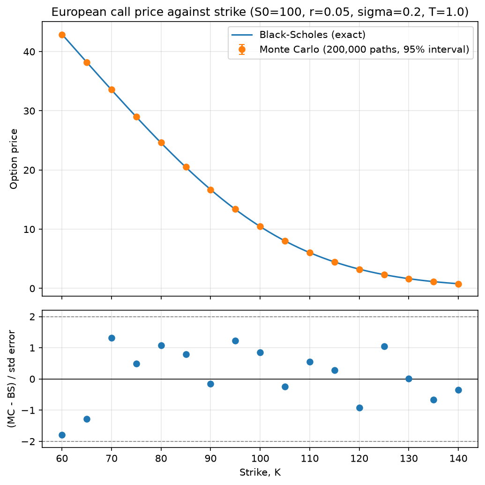
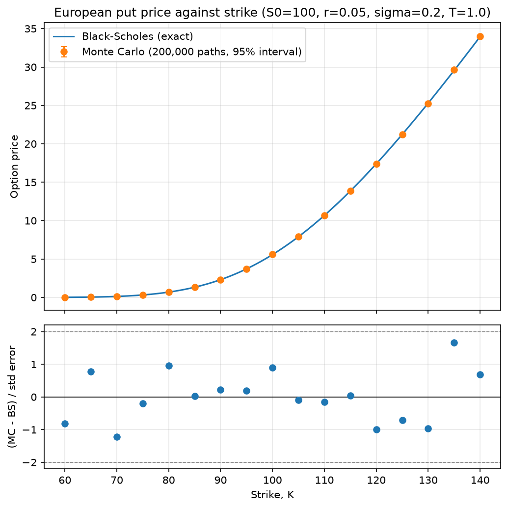

# option-pricer

A small Python package for pricing **European options** under the Black-Scholes model, using:

- the **Black-Scholes closed-form formula** as the exact benchmark, and
- **Monte Carlo simulation** as the approximation method.

The package validates the Monte Carlo estimates against the exact prices and plots how the error shrinks as the number of simulated paths increases.

Scope: European calls and puts only. No Greeks, no early exercise, no dividends.

## Installation

Requires Python 3 and uses only the standard library, NumPy and Matplotlib.

```bash
git clone https://github.com/SamSchubert000/option-pricer.git
cd option-pricer
python -m venv .venv
source .venv/bin/activate        # on Windows: .venv\Scripts\activate
pip install -e .
```

Check the install worked:

```bash
python -c "import option_pricer; print(option_pricer.__file__)"
```

## Quick start

```python
from option_pricer.black_scholes import bs_price
from option_pricer.monte_carlo import mc_price

# S0, K, r, sigma, T, option_type
exact = bs_price(100, 100, 0.05, 0.2, 1.0, "call")
estimate, std_error = mc_price(100, 100, 0.05, 0.2, 1.0, "call",
                               n_paths=1_000_000, seed=42)

print(exact)                    # 10.4506
print(estimate, std_error)      # 10.4532, 0.0147
```

Run the full demonstration (a worked example, the validation report and all figures) with one command from the project root:

```bash
python demo/run_demo.py
```

## Project structure

```
option-pricer/
├── option_pricer/
│   ├── __init__.py
│   ├── black_scholes.py     # closed-form pricer (the benchmark)
│   ├── monte_carlo.py       # Monte Carlo pricer
│   ├── validation.py        # comparison and convergence studies
│   └── plots.py             # figures
├── demo/
│   └── run_demo.py          # end-to-end demonstration
├── data/                    # saved figures
├── pyproject.toml
└── README.md
```

## Methods

**Black-Scholes (benchmark).** Prices a European option with the standard closed-form formula. The normal CDF is built from `math.erf`, so no SciPy is needed.

**Monte Carlo.** Because a European option's payoff depends only on the terminal price, `S_T` is sampled directly from geometric Brownian motion:

```
S_T = S0 * exp((r - 0.5 * sigma^2) * T + sigma * sqrt(T) * Z),   Z ~ N(0, 1)
```

The price is the discounted average payoff. The function also returns the standard error of the estimate, so results can be judged against sampling noise. Sampling is exact (no time-stepping, so no discretisation error) and fully vectorised with NumPy.

**Model assumptions.** Constant risk-free rate and volatility, lognormal prices, no dividends, no transaction costs.

## Validation

`option_pricer/validation.py` runs two checks. Run it on its own with:

```bash
python -m option_pricer.validation
```

**1. Agreement across parameter sets.** Twelve cases cover in, at and out of the money options, low and high volatility, short and long maturities, and calls and puts. A Monte Carlo estimate counts as agreeing with Black-Scholes if it lies within 3 standard errors of the exact price.

> Result: **12 of 12** cases passed with 500,000 paths each. The largest standardised difference was -1.56 standard errors.


**2. Convergence.** For path counts from 1,000 to 1,000,000, the pricer is run 30 times with independent seeds and the root-mean-square error against the exact price is recorded. Monte Carlo error should fall like `1/sqrt(N)`.

> Result: fitted log-log slope of **-0.513** against a theoretical value of -0.5. The RMSE fell from 0.439 at 1,000 paths to 0.013 at 1,000,000 paths, broadly in line with the reported standard error throughout.

## Results

Generate the figures with:

```bash
python -m option_pricer.plots
```

**Convergence of the Monte Carlo error** (at-the-money call, S0 = K = 100, r = 0.05, sigma = 0.2, T = 1):



The error tracks the `1/sqrt(N)` reference line, and the reported standard error is broadly in line with the observed error, which shows the standard error is a reliable measure of uncertainty.

**Price against strike**, with the difference between the two methods in standard errors in the lower panel:




Monte Carlo estimates lie on the Black-Scholes curve, and the standardised differences scatter around zero with no trend.

## Design choices

- **Standard-error test instead of a fixed tolerance.** A fixed price tolerance would be arbitrary. Comparing the difference with the standard error asks whether the methods agree within sampling noise.
- **Reproducibility.** Every random function takes a `seed`. The validation and plotting code draw independent seeds from one master seed, so full reports are repeatable.
- **Functions return data.** Validation and plotting functions return results and figures rather than only printing or showing them, so they can be reused and tested.
- **Input validation.** Invalid inputs (non-positive prices, volatility or maturity, unknown option type, too few paths) raise a clear `ValueError`.

## Limitations

- European options only. American and path-dependent options are out of scope.
- Plain Monte Carlo with no variance reduction, so accuracy improves slowly (halving the error needs four times as many paths).
- Zero maturity or zero volatility is rejected rather than returning intrinsic value.
- Black-Scholes assumptions (constant volatility, no dividends) do not hold in real markets.